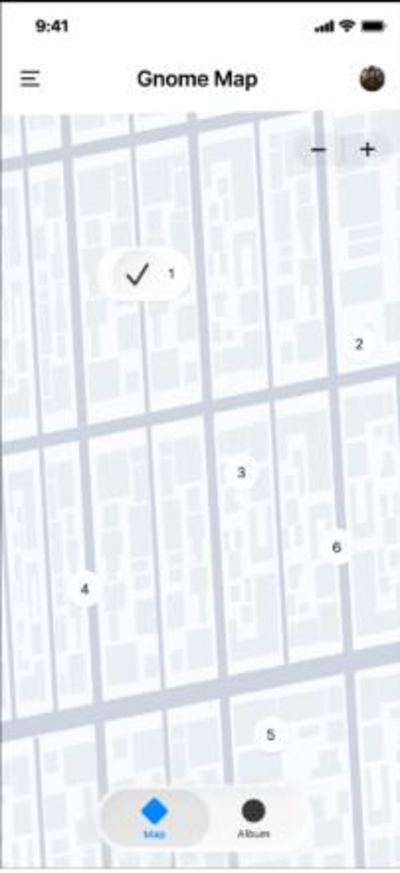

<p align="center">
  
</p>

<h1 align="center">Find the Gnome · Wrocław</h1>

<p align="center">
  App iOS nativa para encontrar, fotografiar y coleccionar los famosos gnomos de bronce de Wrocław (Polonia).
</p>

<p align="center">
  
  
  
  
</p>

---

## 📱 Qué es

Wrocław esconde cientos de gnomos de bronce repartidos por sus calles. **Find the Gnome** convierte buscarlos en un juego: un mapa con 60 gnomos reales del centro, una galería donde vas completando la colección con tus propias fotos y una sección de favoritos.

Proyecto de la asignatura *Mobile Application for iOS* en la **Politechnika Wrocławska** (curso 2025/26), creado por sus dos cofundadores, **Mario Alonso** y **Javier Sardiñas**.

## 🖼️ Capturas

| Pantalla de inicio | Diseño del mapa (Figma) |
|:---:|:---:|
|  |  |
| Vídeo en bucle que abre la app | Prototipo de la pestaña Mapa |

## ✨ Funcionalidades

- 🗺️ **Mapa interactivo** con MapKit centrado en Wrocław. Los marcadores salen en **rojo** si aún no has encontrado el gnomo y en **verde** si ya lo tienes.
- 📸 **Captura**: toca un gnomo, lee su descripción y añade una foto con la cámara o la galería.
- 🧩 **Galería** en cuadrícula con todos los gnomos numerados: ves tus fotos, las amplías, las reemplazas o las borras.
- ❤️ **Favoritos** para tener a mano tus gnomos preferidos.
- 🔍 **Búsqueda** por nombre o por número (`#id`) en el mapa y en la galería.
- 🌟 **Gnomo del día** para animarte a explorar.
- 🎬 **Intro animada** con un vídeo en bucle de un gnomo en 3D.

## 🏗️ Estructura

```
gnome/
├── gnomeApp.swift      # Punto de entrada (@main)
├── ContentView.swift   # Estado, TabView (Mapa, Galería, Favoritos), modelo Gnome y datos de los 60 gnomos
├── GalleryView.swift   # Cuadrícula de la colección
├── ImagePicker.swift   # Puente UIKit → SwiftUI para cámara y fototeca
└── Assets.xcassets     # Icono, color de acento y vídeo de introducción
Tests/
├── GnomeGnomeUnitTests.swift  # Tests unitarios
└── GnomeGnomeUITests.swift    # Tests de interfaz
docs/
├── capturas/           # Imágenes de este README
└── informes/           # Informe técnico, manual de usuario e informe de pruebas
```

## 🚀 Cómo ejecutarlo

1. Necesitas un Mac con **Xcode 26** o superior.
2. Clona el repositorio:
   ```bash
   git clone https://github.com/Mariporg1/find-the-gnome-wroclaw.git
   ```
3. Abre `gnome.xcodeproj`, elige un simulador de iPhone y pulsa **Run** (⌘R).

## 🧪 Pruebas de usuario

La app la probó un usuario en un iPhone 15 Pro con iOS 18.2. Salieron **9 incidencias** (2 altas, 3 medias y 4 bajas), recogidas con sus propuestas de solución en el [informe de pruebas](docs/informes/User_Testing_Report.pdf). Las más importantes para la siguiente versión:

- [ ] Guardar las fotos y el progreso entre sesiones (ahora solo se guardan en memoria).
- [ ] Ajustar la galería a los 60 gnomos que existen de verdad.
- [ ] Agrupar los marcadores muy cercanos en el mapa.
- [ ] Elegir de verdad un gnomo del día al azar.
- [ ] Hacer que funcione el botón de compartir.

## 📄 Documentación

- [Informe técnico](docs/informes/Technical_Report.pdf)
- [Manual de usuario](docs/informes/User_Manual.pdf)
- [Informe de pruebas de usuario](docs/informes/User_Testing_Report.pdf)
- [Diseño en Figma](https://www.figma.com/design/x65lftHTtkMKpSIREw9zAw/Untitled?m=auto&t=cfZ6alW6OBNIz9Tk-1)

## 👥 Cofundadores

- **Mario Alonso López** · [@Mariporg1](https://github.com/Mariporg1) · cofundador
- **Javier Sardiñas** · [@Javisardignas](https://github.com/Javisardignas) · cofundador
